# Mastro Tickets — System Architecture & Technical Diagrams

> **Architecture Classification**: Hybrid Client-Heavy React SPA + Cloud Firestore Direct SDK + Minimal Node.js/Express Media Proxy (`server.ts`), with an optional dormant legacy PHP/MySQL REST API (`/backend/`).

---

## 1. Executive Architecture Summary

The active Mastro Tickets runtime consists of three tiers:

1. **Frontend SPA (React 19 + TypeScript + Vite 8 + Tailwind CSS v4)**
   - Bootstrapped via `/index.html` and `/src/main.tsx`, routed via a custom History API router in `/src/App.tsx`.
   - Centralized state container in `/src/services/store.tsx` (2,596 lines) combining:
     - **Firebase Web SDK** (`auth` + `firestore` with real-time `onSnapshot` listeners and `runTransaction`).
     - **Browser `localStorage`** mirror/fallback for catalog, cart, reservation hold, orders, audit logs, email jobs, inventory ledger, and admin UI session flag.
     - **Optional Remote PHP REST API adapter** (`/src/services/apiClient.ts`) which is **inactive** in standard development/AI Studio deployments (activates only when `VITE_API_BASE_URL` is set or hostname is `mastrotickets.co` / `mastrotickets.ae`).

2. **Active Node.js / Express Server (`/server.ts`, 205 lines)**
   - Runs on `0.0.0.0:${PORT || 3000}`.
   - In development: mounts Vite via `createServer({ server: { middlewareMode: true }, appType: 'spa' })`.
   - In production (`NODE_ENV=production`): serves static assets from `/dist` with SPA fallback to `/dist/index.html`.
   - Exposes **only two active REST API routes**:
     - `GET /api/uploads/cloudinary/status`
     - `POST /api/uploads/cloudinary` (signed SHA-1 upload proxy to Cloudinary API)
   - Does **not** host payment, email, auth, or Firestore Admin SDK routes.

3. **Cloud Services (Direct Client Integration)**
   - **Firebase Project `mastro-tickets`**:
     - Firebase Authentication (Google OAuth popup + Email/Password + password reset + email verification).
     - Cloud Firestore (13 collections accessed directly from browser via `src/services/firestoreRepository.ts`).
     - Firebase Analytics (browser-guarded via `isSupported()`).
   - **Cloudinary**: Admin image uploads signed server-side by `/server.ts` (or optional unsigned preset fallback via `VITE_CLOUDINARY_*`), returning HTTPS CDN URLs stored in Firestore documents.
   - **External QR Generator**: `https://api.qrserver.com/v1/create-qr-code/` invoked directly via `` on `OrderConfirmationPage.tsx`.

4. **Legacy / Dormant Backend (`/backend/`)**
   - Self-contained PHP 8.2 + MySQL/MariaDB REST API designed for Hostinger VPS + Apache 2.4 (`api.mastrotickets.co`).
   - Implements server-side Stripe Checkout Sessions, Stripe webhook fulfillment, Resend transactional email dispatch, and MySQL `FOR UPDATE` ticket holds.
   - **Not running** in the active Node.js runtime; documented separately to avoid confusion between intended PHP capabilities and active Node+Firestore behavior.

---

## 2. Technology Stack & Exact Resolved Versions

Extracted from `/package.json` and `/bun.lock` (Node runtime observed: `v22.23.2`):

### Runtime & Core Dependencies
| Package | `package.json` Range | Resolved (`bun.lock`) | Actual Codebase Usage |
|---|---|---|---|
| `react` | `^19.0.1` | `19.3.1` | Core UI framework |
| `react-dom` | `^19.0.1` | `19.3.1` | DOM renderer (`createRoot`) |
| `firebase` | `^13.4.0` | `13.4.0` | Auth, Firestore, Analytics (`src/firebase.ts`, `firestoreRepository.ts`, `store.tsx`) |
| `express` | `^4.21.2` | `4.22.3` | Active Node server (`server.ts`) |
| `multer` | `^2.5.0` | `2.5.0` | Multipart image upload parsing (`server.ts`) |
| `dotenv` | `^17.2.3` | `17.4.2` | Env loading in `server.ts` (`import 'dotenv/config'`) |
| `lucide-react` | `^0.546.0` | `0.546.0` | UI icons across all pages & components |
| `motion` | `^12.23.24` | `12.43.0` | Installed; check active imports (CSS transitions used primarily) |
| `@tailwindcss/vite` | `^4.3.3` | `4.3.5` | Tailwind v4 Vite plugin (`vite.config.ts`) |
| `@vitejs/plugin-react` | `^6.1.1` | `6.3.0` | React Vite plugin (`vite.config.ts`) |
| `vite` | `^8.3.0` | `8.3.8` | Bundler & dev middleware (`server.ts`, `vite.config.ts`) |
| `@google/genai` | `^2.4.0` | `2.32.0` | **UNUSED** — 0 imports anywhere in `src/` or `server.ts` |
| `eslint` | `^10.15.0` | `10.15.0` | Listed in `dependencies` (should be devDependency); only lints `firestore.rules` |
| `@firebase/eslint-plugin-security-rules` | `^0.0.2` | `0.0.2` | Listed in `dependencies`; used in `eslint.config.js` |
| `@types/multer` | `^2.3.0` | `2.3.0` | Listed in `dependencies` (type definitions) |

### Dev Dependencies
| Package | `package.json` Range | Resolved (`bun.lock`) | Actual Codebase Usage |
|---|---|---|---|
| `typescript` | `^7.0.2` | `7.0.2` | Type checking (`npm run lint` -> `tsc --noEmit`) |
| `tailwindcss` | `^4.3.3` | `4.3.5` | CSS utility framework (`src/index.css`) |
| `tsx` | `^4.21.0` | `4.23.15` | TypeScript runtime for `npm run dev` (`tsx server.ts`) |
| `esbuild` | `^0.25.0` | `0.25.12` | Build toolchain dependency |
| `autoprefixer` | `^10.4.21` | `10.7.0` | Unused directly (Tailwind v4 handles prefixing) |
| `@types/node` | `^22.14.0` | `22.20.5` | Node types |
| `@types/express` | `^4.17.21` | `4.17.25` | Express types |
| `@types/react` / `@types/react-dom` | `^19.3.0` | `19.3.0` | React types |

---

## 3. Architectural Diagrams (Mermaid)

### 3.1 System Architecture Diagram
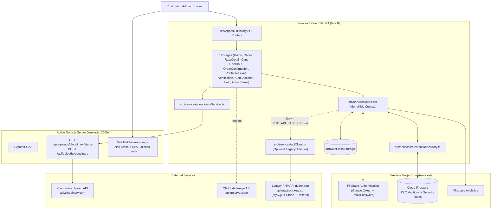

### 3.2 Frontend Architecture & State Flow Diagram
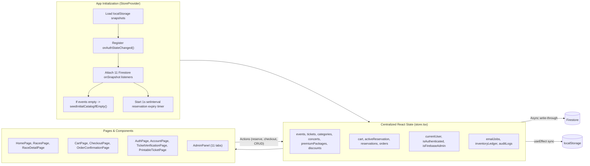

### 3.3 Backend Architecture Diagram (`server.ts`)
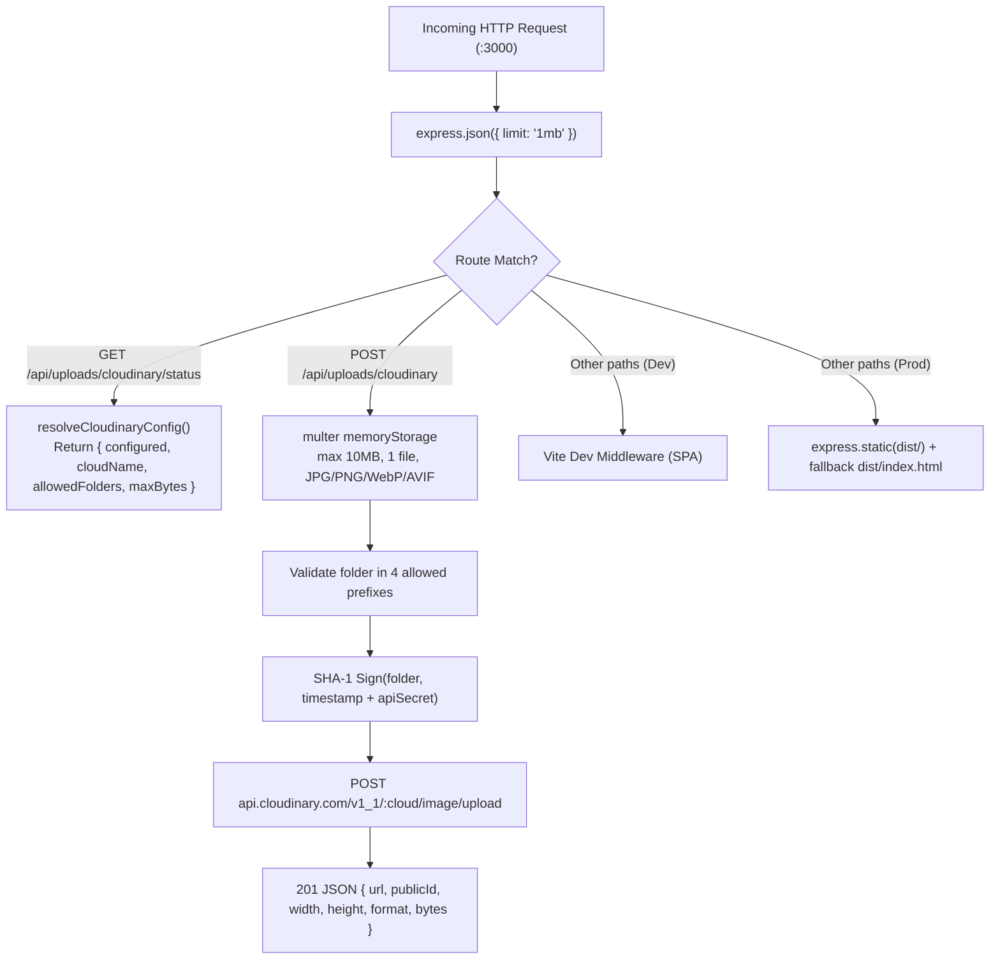

### 3.4 Authentication & Guest Order Claiming Sequence
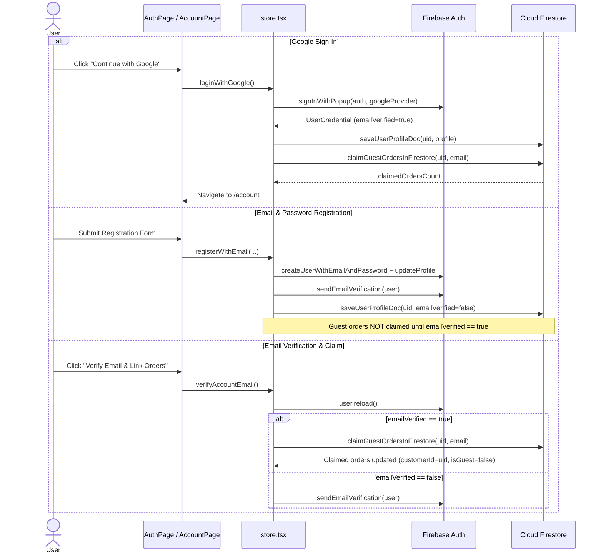

### 3.5 Ticket Reservation Lifecycle & Concurrency Diagram
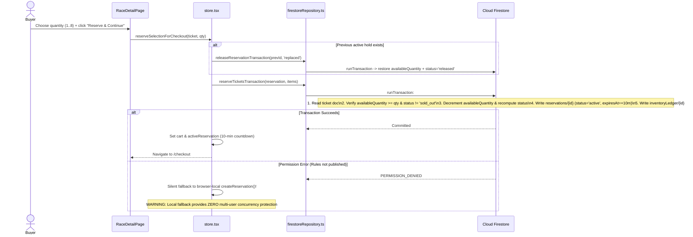

### 3.6 Checkout & Payment Processing Flow (Actual Active Behavior vs Legacy PHP)
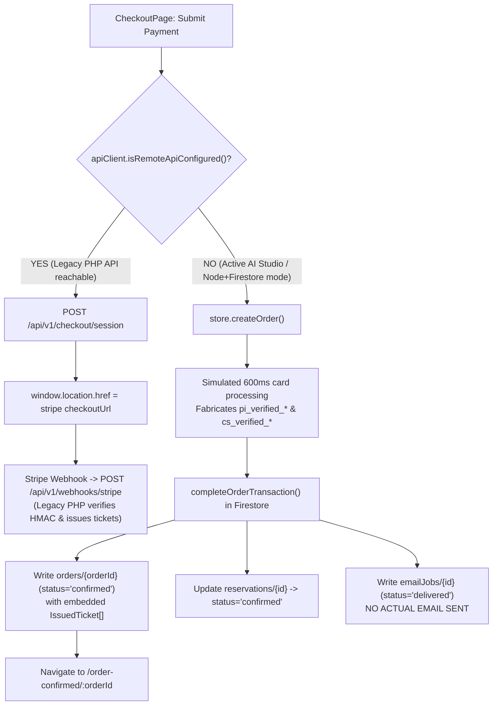

### 3.7 Reservation Expiry Lifecycle (State Machine)
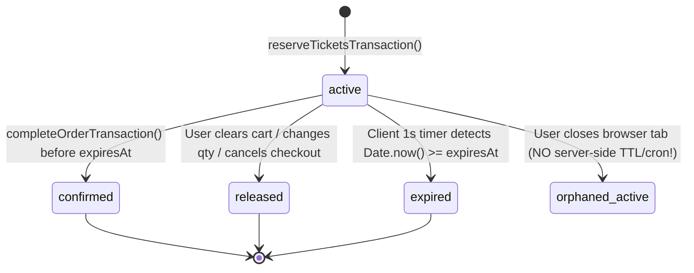

### 3.8 Order Fulfillment & Email Dispatch Flow (Active vs Legacy)
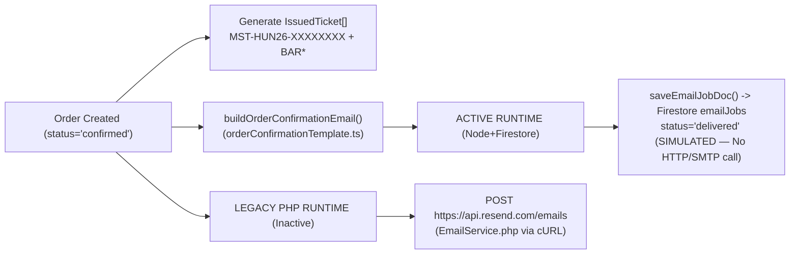

### 3.9 Cloudinary Image Upload Architecture
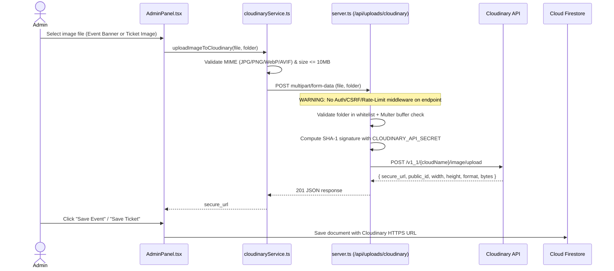

### 3.10 Admin Panel Workflow Diagram
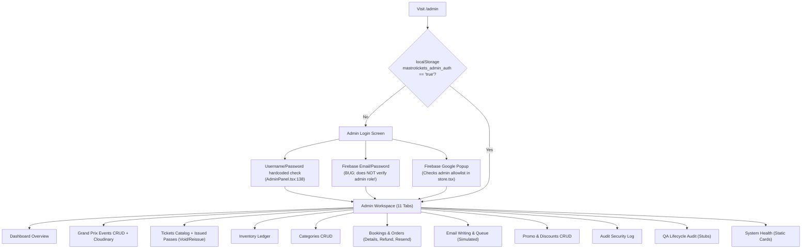

### 3.11 Firestore Data Model (ERD)
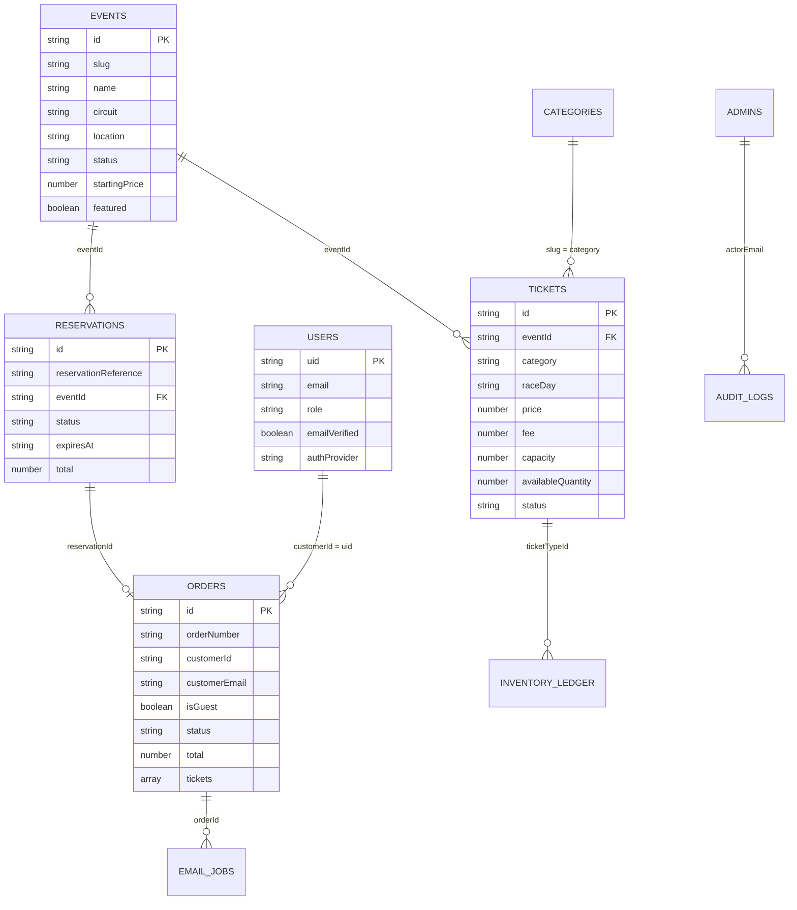

### 3.12 Ticket Verification Flow
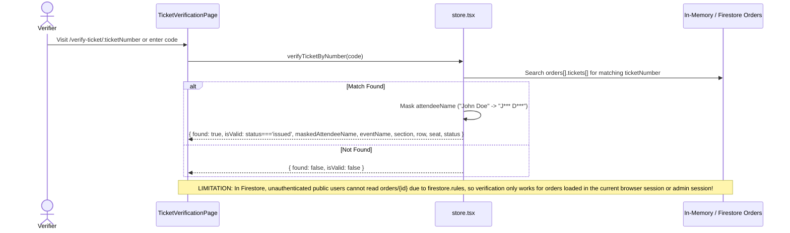

### 3.13 Deployment Architecture Diagram
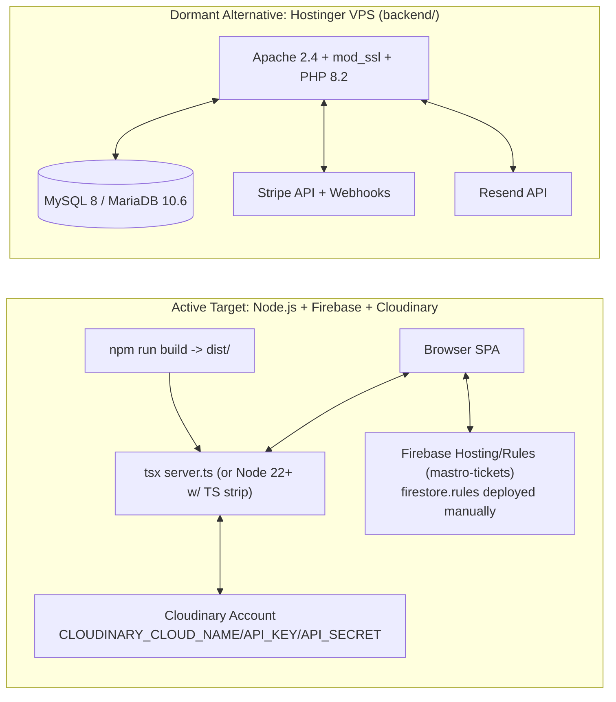
